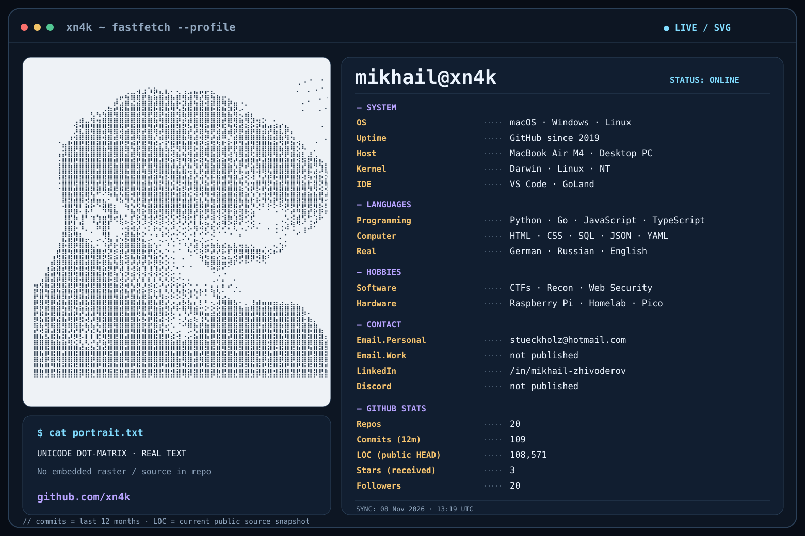

<!-- xn4k / developer profile -->

  <picture>
    <source media="(prefers-color-scheme: dark)" srcset="https://raw.githubusercontent.com/xn4k/xn4k/main/assets/dark_mode.svg">
    <source media="(prefers-color-scheme: light)" srcset="https://raw.githubusercontent.com/xn4k/xn4k/main/assets/light_mode.svg">
    
  </picture>

  
  
  

### `> cat about.md`

Software developer based in Cologne, Germany. I build practical applications, self-hosted systems and security tooling, usually after midnight. Interested in **cybersecurity, reconnaissance, automation, and useful interfaces**. Outside of the terminal: **No-Gi grappling, chess, and tea**.

### `> ls ~/projects/`

| Project | What I've built |
| :-- | :-- |
| **[Hermes](https://github.com/xn4k/hermes)** | Local command center with Vue 3, Go, Docker, PostgreSQL, news feeds and multi-model weather charts. |
| **[ISOBAR](https://github.com/xn4k/WeatherApp)** | Weather application comparing forecast models and visualizing uncertainty, not pretending predictions are guarantees. |
| **[DevPage](https://github.com/xn4k/DevPage)** | Developer portfolio, hidden terminal, and a live security research lab. |

### `> htb --profile`

[View my Hack The Box profile](https://app.hackthebox.com/profile/239301)

### `> git stats --live`

  
  
   
  

### `> cat ~/.contacts`

  
  
  
  
  

<code>Still curious. Still building. Usually after midnight.</code>

<!-- Header images are generated from assets/portrait-braille.txt by scripts/generate_profile.py.
     GitHub Actions updates the SVG stats daily, and can also be run manually.
     The header uses Unicode Braille characters as actual SVG text nodes, not a PNG snapshot. -->
